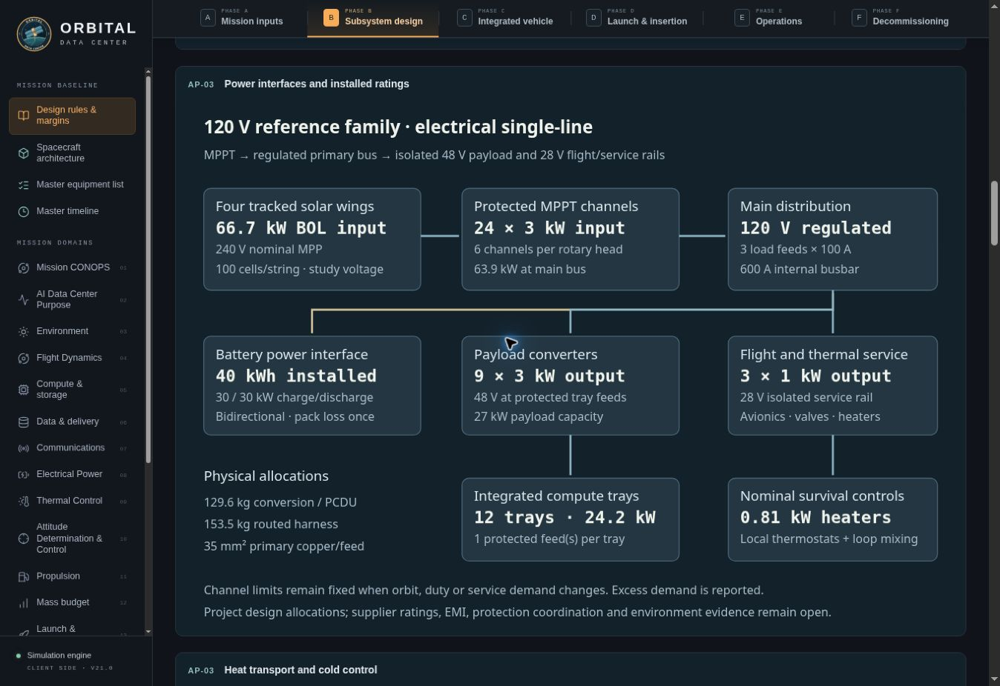

# Orbital Data Center — architecture implementation validation

Date: 6 November 2026  
Release basis: model/workbench **21.0**, **ODC-MB-001 Rev B**, **ODC-01 Rev I**, architecture program **ODC-AP-001 Rev A**.

## Scope and review meaning

The twelve findings from the public-reference architecture gap review are instantiated in six connected design work products. The Mission Baseline, domain assessments, equipment allocations, simulation, explicit sizing proposals and exported review package use the same installed interfaces. The protected central compute core remains the selected topology; the compact-backbone and radiator-local alternatives are matched preliminary comparisons, not silently substituted flight configurations.

The review distinguishes numerical capability, the applicability of a model or interface allocation, external verification evidence, and independent PDR acceptance. Passing a software check does not establish hardware qualification or design closure. Mission, orbit, workload and lifetime edits preserve installed hardware. Hardware changes require explicit design inputs or sizing proposals; controlled margins are not user inputs.

## Implemented architecture boundaries

| Work product | Implemented behavior |
|---|---|
| AP-01 — reference mission and applicability | Controlled 550 km circular / 53° / five-year comparison; first- and last-year seasonal illumination; retained zero-beta eclipse sizing bound; domain-specific applicability. |
| AP-02 — architecture trade | Matched load and resource basis; protected core, compact backbone and radiator-local packaging/mass comparisons; explicit unverified interface costs. |
| AP-03 — energy interfaces | Fixed MPPT and converter ratings, current paths and routed harness; source and load conversion losses; finite battery power; two radiator branches, shared pump station, physical pressure/flow screen, three thermal stores, finite heaters and bypass conductance. |
| AP-04 — compute and Earth service | Counted host/fabric hardware, finite ports and bisection, storage I/O limits, bounded duplex terminal rates, 35-second relay acquisition floor, separate command path, two-slot checkpoints with pending writes and atomic commits. |
| AP-05 — mechanics and control | Attached deployment, preliminary load-path and flexibility bounds, factored mechanism torque checks, body versus terminal pointing allocation, navigation and deterministic propulsion sensitivity. |
| AP-06 — assurance and verification | Mission-specific radiation/life and heritage deltas, independent flight control, recovery/data-custody responsibilities, item growth-assignment status and owned evidence gates. |

## Focused validation evidence

The following suites were run during this implementation. Each named result is a completed run; test grouping differs by suite.

| Check | Result and scope |
|---|---|
| `architecture-design-checks.mjs` | PASS — matched architecture, structural/mechanism bounds, applicability, radiation/life and propulsion sensitivity. |
| `energy-design-checks.mjs` | PASS — 18 groups including fixed ratings, physical hydraulics, electrical/thermal conservation, independent exposed/coupled radiator area and actual served-load presentation. |
| `pdr-applicability-checks.mjs` | PASS — domain-specific applicability, numerical status and evidence status remain separate. |
| `pdr-flight-checks.mjs` | PASS — flight-domain preliminary assessments. |
| `pdr-resources-checks.mjs` | PASS — 9 groups covering physical resource interfaces and numerical/evidence distinctions. |
| `service-architecture-checks.mjs` | PASS — 12 groups covering host/fabric/storage/terminal allocations and mission invariance. |
| `pdr-service-checks.mjs` | PASS — 9 service-domain assessment groups. |
| `checkpoint-runtime-checks.mjs` | PASS — two atomic commits and five deferred requests; maximum combined writes 20.000 MB/s against 20.000 MB/s installed; prior complete checkpoint retained through partial replacement. |
| `pdr-integration-checks.mjs` | PASS — four groups covering fixed vehicle identity, controlled margin thresholds, all 17 domain assessments, exports and asset inventory. |
| `mission-baseline-checks.mjs` | PASS — eight groups; 77 active GOLD rules and all 136 numbered slots accounted for. |
| `equipment-list-checks.mjs` | PASS — 31 allocations, nine rollups, eight spacecraft mass accounts, instantaneous served power and installation provenance. |
| `input-guidance-test.mjs` | PASS — 244 controls, 248 persisted fields, ten launcher choices and 108 located references. |
| `pdr-ui-checks.mjs` | PASS — actual application handlers exercised in a lightweight DOM harness; mission edits, explicit sizing, locked policy and prelaunch unassessed state. |
| `thermal-test.mjs` | PASS — commissioning/window thermal audit, component-state limits, independent physical temperatures and thermal starvation behavior. |
| `audit-test.mjs` | PASS — chronological replay, partial final day, accounting, restart invariance, five physical failure modes and three named mission scenarios; hardware lifetime cannot extend past modeled coverage. |
| `ai-service-test.mjs` and `ai-core-checks.mjs` | PASS — service pipeline and worker transport, six customer purposes, replay closure, route exclusivity and training orders. |

Electrical conservation checks reconcile the equipment list with served bus load. The three-store thermal exchange uses equal and opposite internal heat transfers, with a nonlinear radiation solve and numerical residual checks. Radiator exposure is independent of coolant admission: exposed restrained or unfolding panels exchange environmental heat before flow, while the carrier-attached launch boundary remains prescribed. Partial-deployment exposure is a declared geometric approximation, not a correlated panel-temperature model.

The review export retains the 17 original domain graphics, adds seven architecture-program SVGs and eight supplemental domain-graphic occurrences, and includes architecture/energy/service/applicability/trade/illumination records plus the gap implementation and work-product registers. The five commissioning-interface gate rows are present in both the Mission Baseline and the serialized architecture record. The bounded export check verified all 17 domains, 167 checks, all 248 configuration inputs, an exact configuration round trip and no missing local assets. The package contains 156 files at this release's tested case; resource values and file sizes depend on configuration.

Browser review covered the Mission Baseline architecture tab, power and thermal drawings, the three assessment status areas and the explicit electrical-family selector. The interface drawings remain readable at the review viewport. Runtime console messages from the browser extension were excluded from application-error reporting.

Two late integration corrections were verified: the plotted power allocations now sum to actual served demand, including the partially powered case; and hardware lifetime is capped at modeled hardware coverage while later disposal outcomes remain separately reported. These are reporting/accounting corrections, not changes to the required engineering margins.

## Reference-case findings retained for review

Case: live text reference, 550 km circular orbit, 53° inclination, five years; 12 compute trays, 190 m² PV, 65 m² radiator planform, 40 kWh battery and 450 kg loaded liquid propellant. Installed vehicle identity: **VEH-A9EABA0E**.

| Quantity | Result | Interpretation |
|---|---:|---|
| Basic installed hardware | 3,442.129 kg | Before carried dry growth. |
| Carried dry growth | 516.319 kg | Growth-assignment evidence remains visible. |
| Predicted dry spacecraft | 3,958.448 kg | Hardware plus carried growth. |
| Separated wet spacecraft | 4,409.745 kg | Includes liquid propellant and helium pressurant. |
| Launch stack | 4,589.745 kg | Includes 180 kg launch-only adapter. |
| Nominal propulsion consumption | 335.738 kg | Below 393.750 kg usable after carried reserve and residual. |
| Deterministic propulsion stock requirement | 500.436 kg | A 50.436 kg stock shortfall against the installed 450 kg. This is a sensitivity result, not a solved new propellant load. |
| Four-longeron yield / ultimate / Euler margins | −29.683% / −18.382% / −9.131% | Conservative +6 g axial / +2 g lateral project screen, with no sandwich-wall load-sharing credit. |
| First-mode lower bound / body-control bandwidth | 14.836× | Meets the project ≥5× separation screen; correlated flexible dynamics remain open. |

The reference is inside the preliminary study envelope while retaining the listed numerical shortfalls. A statistical 3σ propulsion assessment is unassessed. Supplier curves and exact configurations, ammonia compatibility and joint life, part-specific radiation data, provider service interfaces, launch coupled loads, hardware tests and independent acceptance remain evidence work. These items are recorded as gates with owners and methods rather than represented as completed qualification.
