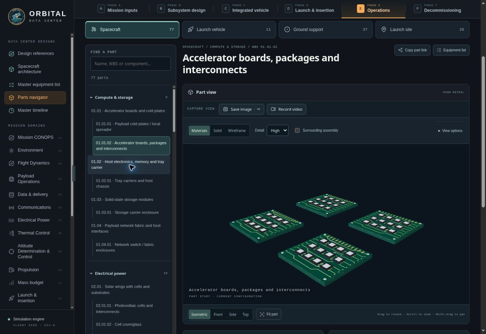
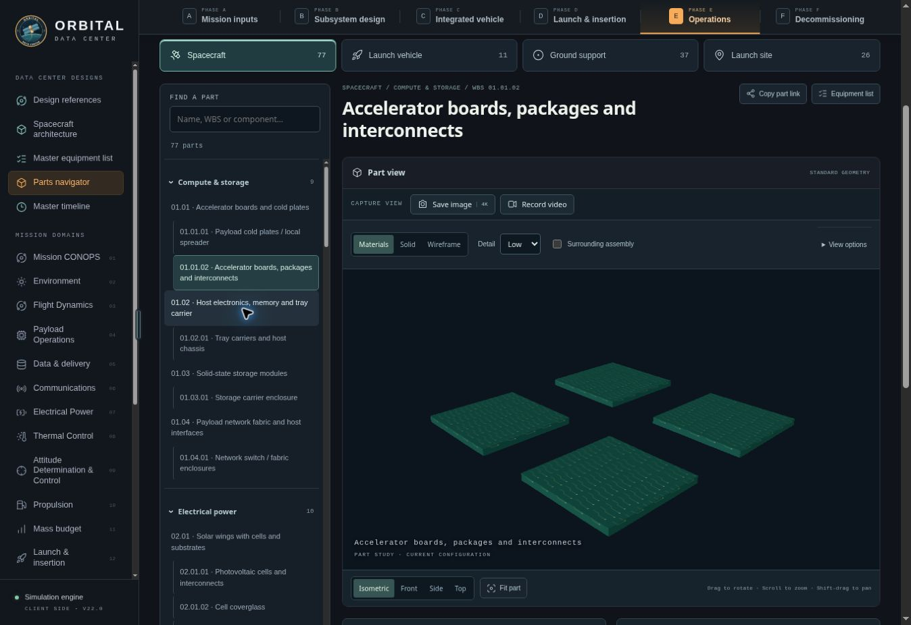
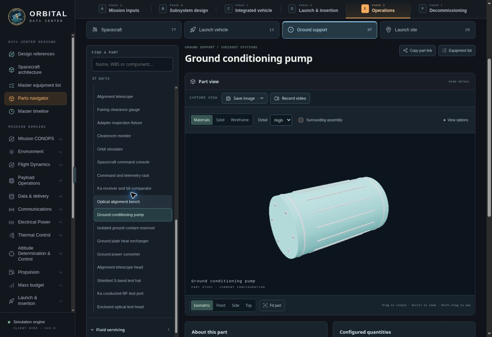

# Adaptive hardware detail — 7 November 2026

## Delivered behavior

The parts navigator now defaults to High geometry detail. Auto and Low are also selectable and preserved with part-view preferences. High prioritizes the selected component within the renderer's limits; surrounding assembly context stays lightweight. MEL thumbnails use the same detailed parts through the existing single, queued offscreen renderer, then retain static raster images.

The integration, spacecraft, core and launch scenes default to Auto. Detail follows projected component size, selected hardware and the current domain or facility station. Far-away, offscreen, invisible and ghosted context hardware stays at its original geometry. The Earth-orbit overview does not activate component refinements. Auto, High and Low controls remain available alongside the other scene appearance controls. High is a preference within bounded resource limits, not an instruction to detail the entire spacecraft at once.

Each source mesh retains its authoritative original geometry. Medium and High recipes add private visual geometry attached to the same animated source. Returning to Low restores the exact original object and cylinder UV seed. Detail picking resolves to the existing part identity, so its action menu and linked part page are retained. The temperature overlay suppresses decorative detail surfaces to preserve its temperature mapping.

## Geometry and materials

Flight detail recipes cover the 38 physical material roles found across the seven spacecraft architecture families: frame and panel interfaces, electronics cases and board assemblies, cold plates, batteries, CMGs, magnetic rods, pressure vessels, plumbing, propulsion, antennas and optical terminals, solar blankets and deployment equipment, radiator faces and edges, harnesses, insulation and launch interfaces. Standard boxes have actual small-radius bevels; safe cylinders, spheres and rings have smoother private geometry. Special cutouts and authoritative custom geometry are preserved.

Launch and ground recipes add appropriate casing, flange, structural and interface features to barrels, fairings, nozzles, adapters, racks, pumps, hoses, connectors, carts, hoists, carriers, platforms, launch tables, restraints and utility hardware. Angular refinement preserves rotational profiles and openings. Features are combined by material to avoid a draw call for every fastener.

The inspection palette reuses the existing physical finish library. Small procedural textures add solder-mask traces, package markings, generic equipment tags, caution stripes and ribbed grips. Printed labels have a 32-entry shared cap. There are no new binary media downloads and no invented company or mission marks. Existing real liveries and graphics are excluded from detail recipes.

These features are illustrative manufacturing detail for the workbench's engineering models, not supplier CAD. They do not add equipment quantities, mass, power, rated capability or analytical surface area to the design ledger.

Representative individual source meshes, including their base geometry:

| Component | Original triangles | High-detail triangles |
| --- | ---: | ---: |
| Engine nozzle | 384 | 6,656 |
| Fairing half shell | 896 | 4,240 |
| Conditioning pump | 80 | 3,048 |
| Instrumentation rack | 12 | 2,472 |
| Traveling hoist | 12 | 5,352 |
| Ground-service hose | 576 | 2,272 |

These are available model variants. A scene activates only the subset that fits its current visibility and resource budget.

## Resource policy

The controller builds detail lazily, normally in batches of at most three new variants / approximately 4 ms per scene pass, or twelve / approximately 9 ms per part-view pass. A recipe can exceed the target duration individually; the limit governs when another recipe is started. Thumbnail preparation completes one bounded batch synchronously before rasterization.

Starting caps for additional geometry and draw calls per controller are:

| Renderer / surface | Additional triangles | Additional draw calls | Active detailed sources | Geometry cache |
| --- | ---: | ---: | ---: | ---: |
| Standard WebGL scene | 110,000 | 160 | 36 | 28 MiB |
| Standard WebGL part | 220,000 | 280 | 72 | 48 MiB |
| Compact WebGL scene | 60,000 | 100 | 22 | 16 MiB |
| Compact WebGL part | 120,000 | 180 | 42 | 28 MiB |
| Software scene | 6,500 | 24 | 6 | 6 MiB |
| Software part | 22,000 | 64 | 18 | 12 MiB |
| Software thumbnail | 14,000 | 48 | 14 | 10 MiB |

Launch scenes can contain both a launch-hardware and a live-spacecraft controller; each remains independently bounded. These caps govern added inspection detail, not the existing base scene, Earth imagery or renderer framebuffer. Browser-reported low-memory / low-core devices start at the compact profile. Sustained measured render cost gradually lowers detail budgets to a minimum 45% of the profile; sustained recovery restores them gradually. Idle time and mission computation are excluded from the render-cost measurement.

Projected-size thresholds use hysteresis. Evaluation normally runs at a 180 ms cadence; a single deferred wake ensures a final wheel or drag event still gets its settled evaluation. Pending preparation ends when the useful budget is filled. Rejected variants retain small cost metadata after geometry eviction, preventing rebuild/eviction loops at budget saturation. Once settled, refinement requests no continuing animation frames. Existing selected animations and mission playback retain their normal schedules.

New facility stations are discovered after they are created. Detached station geometry is returned to its original state; private refinements are released while the factory keeps ownership of its reusable base meshes. Private geometry caches and the shared inspection material pool are released on view/model disposal.

## Related selector corrections

The detail coverage audit exposed existing paths that hid actual modeled hardware from part pages. Numeric array paths now select the two distinct Falcon Heavy booster groups correctly. Starship lifting fixture pages use the existing handling interval where the yoke/frame are visible. The Starship water page selects its existing cooling manifold and injection nozzles. Its absent separate adapter stand and unresolved lightning topology remain explicitly unavailable.

## Automated verification

- `flight-detail-checks.mjs`: 445 modeled flight part pages across seven architecture families; finite geometry, role coverage, preserved source data and envelopes, nonuniform-scale fasteners, cylinder UV transitions and animation attachment.
- `ground-detail-checks.mjs`: 6,091 actual source meshes across three launchers; every available launch/GSE/site page has detail (75 Terran R, 78 Starship, 87 Falcon Heavy); source/ledger immutability, open nozzles and apertures, lazy stations and bounded software detail.
- `hardware-detail-checks.mjs`: perspective/orthographic projected size, frustum and visibility, focus/context, hysteresis, thermal gating, exact restoration, private resource disposal, saturated-budget convergence and adaptive cost reduction/recovery.
- `detail-material-checks.mjs`: shared physical finishes, procedural pattern pixels, bounded labels and multi-view lifecycle.
- `parts-viewer-checks.mjs`: rendered High/Low pixel differences, real component identity, selected-only detail, repeated stations, unchanged selection membership, modes, animation and capture lifecycle.
- `wireframe-rendering-checks.mjs`: actual depth-tested triangle edges in the software renderer, high/low edge density, sparse interiors, occlusion, near-plane and viewport clipping; ordinary filled rendering remains unchanged.
- Existing orbital camera, scene action-menu, parts catalog, reference-history and material/MEL checks; syntax, whitespace and offline asset-manifest checks.

Additional asynchronous checks prove a final camera/pose change receives one settled wake, identical views schedule none, disposal cancels pending wakes, and a capture-preview listener does not produce recurring revision or frame notifications.

## Browser verification

The managed browser had WebGL disabled and exercised the Canvas software fallback. Checked actual High/Low electronics output, the detailed pump's visible cap fasteners, corrected wireframe output, CMG play/pause with attached detail, facility station changes, scene Auto/Low controls, and the Earth-orbit overview. The electronics material page showed 7,024 additional triangles in four additional draws; Low returned both counts to zero. The power facility showed 12,398 additional triangles / 13 draws across its separate bounded spacecraft and facility controllers; Low returned to zero. The spacecraft view showed 4,112 additional triangles and switching to Earth Orbit released all active component detail.

The filtered MEL rendered a completed 176 × 116 static thumbnail and contained zero canvases in its equipment table. Browser console entries from the site were the expected WebGL-context failures before the working software fallback; no other site error appeared in the reviewed log. Native-GPU frame rates on a representative set of end-user devices were not benchmarked. The implementation bounds added work and responds to render cost rather than promising a universal frame rate.

### Visual evidence

High detail:

The same view using original geometry:

Ground equipment:

