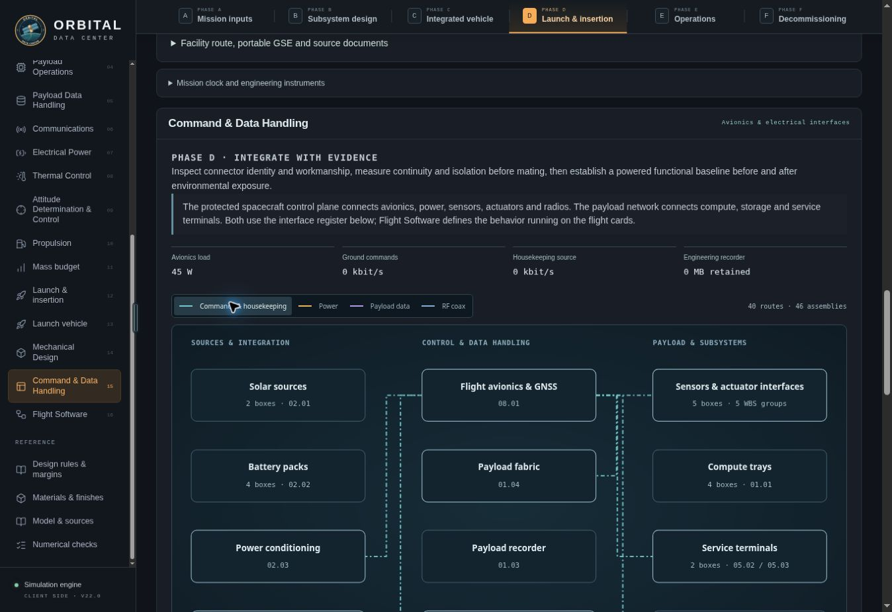
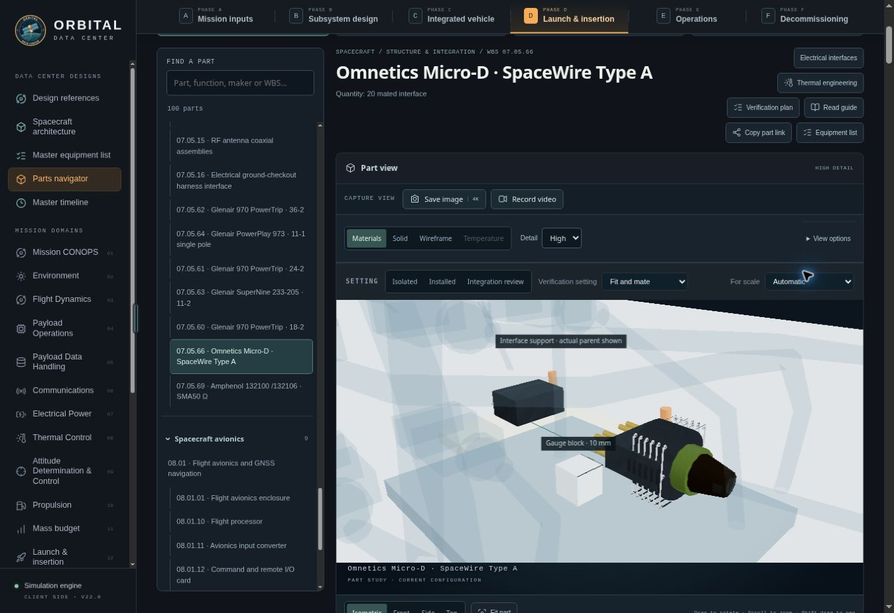

# Avionics and harness engineering release note

**Date:** 8 November 2026  
**Baseline:** `electrical-interfaces-2026-11-r1` / `electrical-program-2026-11-r1`  
**Release state:** Engineering publication gate passed. Deployment is tracked by the Sites version record. This document records the implemented preliminary engineering baseline; it does not assert procurement release, hardware acceptance or flight qualification.

## Engineering decisions

The workbench now uses the following division of responsibilities. These numbered workspaces are the project's organization. [NASA's avionics scope](https://www.nasa.gov/smallsat-institute/sst-soa/small-spacecraft-avionics/) supports the distinction between spacecraft C&DH, flight software and payload/subsystem avionics; NASA does not prescribe this exact sixteen-domain taxonomy.

| Domain | Responsibility |
| --- | --- |
| **04 — Payload Operations** | Admit and execute the selected AI workload; track useful work, completion and customer acceptance. |
| **05 — Payload Data Handling** | Track incoming requests/datasets, resident models, local fabric exchange, storage reads/writes, checkpoints, output queues and Earth receipt. |
| **15 — Command & Data Handling** | Connect flight avionics, time, spacecraft commands, housekeeping, engineering recording, power interfaces and the controlled electrical interconnect register. |
| **16 — Flight Software** | Define onboard behavior, scheduling, mode transitions, interlocks, recovery and software resource/timing obligations. |

Electrical Power retains responsibility for generation, conversion, distribution and protection. The shared C&DH register makes its connections visible without adding a second set of masses to the spacecraft ledger. The SEMP/design-rule mapping now identifies the electrical ICD and applicable [GSFC GOLD rules](https://standards.nasa.gov/standard/gsfc/gsfc-std-1000): 2.05 grounding, 2.06 fusing, 2.13 mating, 2.22 HV corona-region testing and 2.25 electrical interface verification.

## Shared implementation

One configuration-owned graph supplies equipment ports, connector selections, pin/net maps, cable construction, route and cut length, installed quantity, source provenance and procurement/evidence status. It drives:

- MEL harness/connector/card entries and their linked Parts navigator pages;
- box-level power, command/housekeeping, payload-data and RF diagrams, plus the avionics card diagram;
- physical receptacles, plugs, backshells and routed cables in spacecraft, integration and part views;
- connector mating and electrical-checkout rehearsals, with color and line-pattern distinctions;
- electrical requirements, verification plans, runnable numerical checks, and CSV/JSON exports.

Routes terminate at actual connector datums and retain bend/slack allowances through deployment poses. Moving harnesses retain open flex-life/slip-ring and supplier-application obligations. The removable **3 m G-EGSE lead** is a distinct ground article, appears in the build export and remains excluded from flight mass and installed flight quantities.

Payload-flow views use the mission simulation's actual accepted input, local reads, product generation, checkpoint writes and returned-product rates. Training rereads its resident corpus; a local checkpoint write does not imply an Earth delivery. Input, customer-product, shared-recorder and supplemental-traffic ledgers expose conservation errors instead of masking them with zero defaults. Service links resolve to the active installed terminal.

## Real hardware references and allocation boundaries

The selections below are authentic supplier families or products. Final order suffixes, manufactured cable lengths and application approval remain controlled procurement inputs. Their use here does not claim that any reference company's actual spacecraft uses them.

| Interface | Selected real reference | Implemented allocation / boundary |
| --- | --- | --- |
| Low-voltage power | [Glenair 970 PowerTrip](https://www.glenair.com/powertrip/pdf/insert-arrangements-current-rating-wire-diagram-sealing-range.pdf), 18-2 / 24-2 / 36-2 | Two #8 / #4 / 2/0 copper contacts. Supplier limits 60 / 100 / 205 A; project contact allocations 30 / 50 / 102.5 A. The conductor screen can be stricter. |
| Small service branches | [SuperNine 233-205](https://www.glenair.com/supernine/environmental/pdf/233-205.pdf), [11-2 arrangement](https://www.glenair.com/supernine/reference/pdf/mil-std-1560-and-other-standard-contact-arrangements.pdf) | Two #16 contacts, AWG16–20, supplier 13 A maximum. Project contact allocation 6.5 A; the 3 A/mm² screen limits AWG16 to 3.93 A. Separate voltage-family keying. |
| High-voltage power | [PowerPlay 973 G6 plug](https://www.glenair.com/powerplay/supernine/series-iii/pdf/973-001-g6-plug.pdf) / [00 receptacle](https://www.glenair.com/powerplay/supernine/series-iii/pdf/973-001-00-d0-cs-panel-mount-receptacles.pdf), 11-1 #8 or 17-1 1/0 | Separately keyed feed/return single poles. Project allocations 25.11 A or 100 A and a 1000 V application ceiling require supplier approval. Published dielectric-withstand tests do not establish working voltage in vacuum. |
| Spacecraft control | [Omnetics Micro-D SpaceWire](https://www.omnetics.com/wp-content/uploads/2025/07/Spacewire.pdf), [ECSS Type A](https://ecss.nl/wp-content/uploads/2019/05/ECSS-E-ST-50-12C-Rev.1%2815May2019%29.pdf) | Four differential pairs, prescribed crossover, cable position 3 unpopulated and shell shield termination. Project 100 Mbit/s raw signaling, 10 ± 1 Mbit/s startup; ideal byte payload is at most 80 Mbit/s before further overhead. |
| 100G payload fabric | [Corning OM4 Type-B MTP](https://www.corning.com/content/dam/corning/catalog/coc/documents/application-engineering-notes/AEN151.pdf), with [NVIDIA MMA1B00-C100D](https://networking-docs.nvidia.com/mma1b00c100dspec) | MPO/UPC 100GbE SR4. A 50 Gbit/s allocated workload uses the selected 100G physical interface. Terrestrial products require space adaptation and qualification. |
| 400G payload fabric | [NVIDIA MFP7E10-Nxxx](https://docs.nvidia.com/nvidia-mfp7e10-nxxx-optical-multimode-fiber-cable-product-specifications.pdf) | MPO/APC, Type B, eight active fibers, 400G per branch. APC and UPC cannot intermate. A twin-port 800G interface uses two 400G branches. |
| GNSS / S-band RF | [Amphenol 132100 plug](https://www.amphenolrf.com/en-us/part/132100/705/) / [132106 jack](https://www.amphenolrf.com/en-us/part/132106/679/), [TFlex-402 cable](https://timesmicrowave.com/wp-content/uploads/2024/04/tflex-brochure-web.pdf) | 50 Ω; the connectors' 18 GHz limit covers these feeders, not the 26 GHz Ka feed. Cable/connector losses and finished-assembly environmental performance require measurement. |

The interface model retains the actual 120/400 V primary, 48 V payload and 28 V service architecture. Solar open-circuit limits of 360/900 V trigger the single-pole HV treatment even where the primary bus is 120 V, following [NASA-STD-8739.4A §7.2.6](https://standards.nasa.gov/sites/default/files/standards/NASA/A/4/nasa-std-87394a_w_change_4_0.pdf). Project routing screens use at least 10 cable diameters statically and 15 at moving interfaces. Power-loss prediction includes both conductors and four mated-contact resistances per complete feed/return circuit.

## Functional and card capabilities

The **12 kg / 45 W** avionics allocation is divided among the processor, input converter, command/remote-I/O card, engineering recorder, GNSS receiver, backplane/enclosure and external GNSS antenna. These are functional project cards, with their own part pages and requirements. [Moog's IAU](https://www.moog.com/content/dam/moog/literature/sdg/space/avionics/moog-integrated-avionics-unit-datasheet.pdf), [BAE's RAD750](https://www.baesystems.com/en-us/dam/jcr%3Ae2c04c2e-8dea-425c-8460-96a509a95111/16-f76-RAD750-3U-CompactPCI-datasheet-2025-web.2025-06-25-21-58-21.pdf) and [NASA's Perseverance computer](https://science.nasa.gov/mission/mars-2020-perseverance/rover-components/) supply capability precedents, not the project's internal schematic.

| Capability | Current project requirement |
| --- | --- |
| Avionics supply | Protected 28 V nominal, 22–34 V operating input; regulated 3.3/5 V card rails with ±5% allocation. |
| Flight executive | 50 Hz, 20 ms major frame, at most 10 ms allocated execution per frame. |
| Working memory | At least 256 MB usable error-managed memory; at most 128 MB operational allocation. |
| Remote I/O | 32 analog channels, ±10 V range, 12-bit conversion and 100 samples/s/channel; 32 discretes. |
| Navigation/time | 10 Hz observations, 1 PPS and 1 ms time-correlation budget. |
| Engineering recorder | Selected capacity and housekeeping cadence checked against the active autonomy history requirement; independent of customer storage. |

WCET, memory peaks, analog accuracy/thresholds, time performance, board-level net mapping and physical signal integrity remain implementation and measured-verification obligations.

## Requirements, verification and remaining engineering work

Every electrical article has allocated criteria, source links, planned analysis/inspection/test/demonstration methods and evidence obligations. Phase A defines boundaries; B establishes the PDR interface/verification baseline; C releases detailed build definitions; D integrates and verifies articles; E trends operation; F preserves final commandability and records. Electrical articles also receive explicit thermal allocations.

[GEVS §2.3](https://standards.nasa.gov/system/files/tmp/GSFC-STD-7000B_Approved_Admn%20Ext.pdf) supplies functional-verification practices, including pre-mating checks and hot/cold performance at input-voltage extremes. The electrical ICD supplies the actual voltage, signal, timing, pin and response criteria. Browser runs retain configuration and evidence identity, classify outputs as **predictions**, and leave hardware verification open. Rehearsal motion does not certify continuity, BER, insulation, EMC or environmental acceptance.

**Route-based mass closure remains an exposed design shortfall.** The model preserves the existing parent mass budget and separately reports the material/termination estimate. For the current Redwire 8 kW workbench baseline (`ELC:3c4b0e10`):

| Parent allocation | Retained budget | Route-based estimate | Shortfall |
| --- | ---: | ---: | ---: |
| 07.05 installed harness/connector register | 53.298 kg | 88.829 kg | 35.531 kg |
| 01.04 payload fabric cabling/terminations | 0.840 kg | 0.993 kg | 0.153 kg |

These are preliminary workbench estimates, not measured hardware masses or claims about the reference provider. Routing, conductor/connector sizing and procurement mass must be reconciled with the system budget before design release. Supplier application approval, final purchase specifications, vacuum/pressure-transition HV behavior, radiation/outgassing, moving-cable life and serialized acceptance evidence remain open.

## Validation record

Counts below aggregate the regression configurations; they are not one vehicle's equipment quantities.

| Validation | Verified result |
| --- | --- |
| Geometry | **1,696 routes, 3,392 interfaces, seven design families, five deployment poses**; rendered endpoint closure, flange support/separation, model/render datums, cut-length allowance, mating travel and part identity checked. |
| Electrical model | **4,692 physical connector interfaces and 173 explicitly allocated electrical thermal articles**; required-input, pin-map, termination, polarity, source, mass and evidence regressions passed. |
| Electrical UI | **622 diagram/build links** resolved; electrical requirements and verification profiles linked to part pages; invalid input cases display their actual errors. |
| Payload contracts | **49 checks passed, zero failed**, across **36 reference/workload combinations**; bounded mission integrations also exercised the shared conservation ledgers. |
| Browser / files | Live part links and electrical rehearsal exercised. Downloaded check JSON contained **296 checks and two mass shortfalls**; harness CSV contained **41 rows**, including the excluded 3 m G-EGSE lead. |
| Publication gate | **Passed:** 17 configurations, 3,051 part instances, 6,287/6,287 thermal plans ready, 848 complete thermal predictions, 1,435 electrical requirements, 1,318 electrical verification plans and 15,776 electrical checks. Zero readiness issues; 25 predicted electrical shortfalls remain visible. |
| Browser regression | Connector mating selection remains selected after pause and position reset; small connectors retain useful close-up framing across their full mating travel. Harness search and pin-map details work. Baseline/check JSON and build CSV were read back successfully. |

Reproducible checks: `electrical-model-checks.mjs`, `electrical-geometry-checks.mjs`, `electrical-ui-checks.mjs`, `payload-data-checks.mjs` and the existing parts/catalog/verification gates. Detailed source reasoning and alternatives are retained in [avionics-harness-research.md](avionics-harness-research.md); current implemented allocations in this release note supersede its preliminary alternatives.

## Browser review

The complete publication readiness report is retained in [avionics-harness-readiness.json](avionics-harness-readiness.json).
