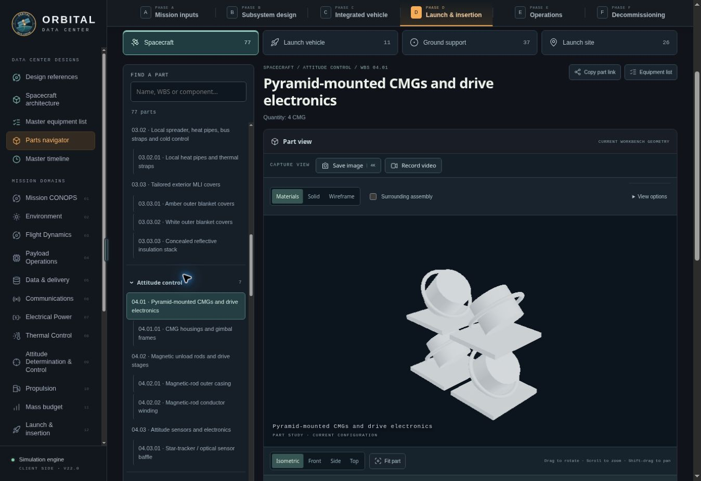
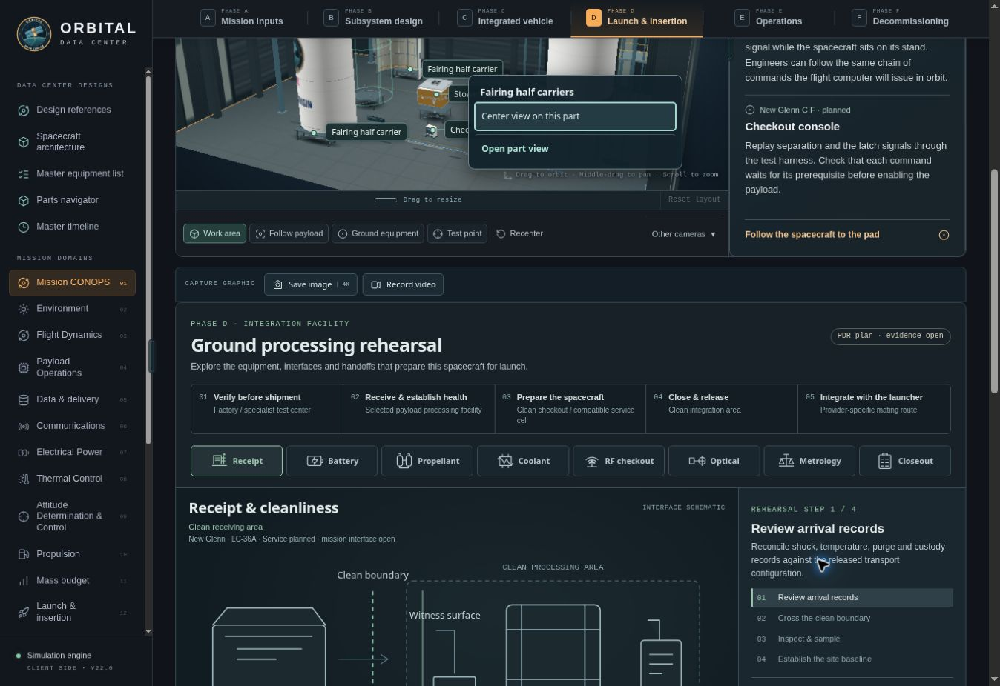

# Parts navigator — 7 November 2026

## Delivered behavior

Added a dedicated Parts navigator alongside the Master equipment list. Each catalog entry has a stable URL and a focused page with the active configuration's 3D geometry above its engineering information. The catalog separates spacecraft hardware, launch vehicle, ground support and launch-site equipment. It includes reciprocal assembly/component relationships, material links and source references.

The Redwire reference currently exposes 151 records: 77 spacecraft entries (31 MEL allocations and 46 material details), 11 launch-vehicle entries, 37 ground-support entries and 26 launch-site entries. Counts adapt to the installed architecture and launcher. Materials and non-flight equipment remain outside additive spacecraft mass accounting.

Part views reuse private instances of the existing spacecraft and launch model factories. They provide material, solid and wireframe modes; isolated or ghosted assembly context; perspective and orthographic cameras; named views and fit; axes, turntable, lighting and exposure; and applicable existing deployment, gimbal, terminal, integration and service-disconnect motion. Camera targets follow translating fixtures while retaining the selected view angle and pan. Absent geometry and shared-package context are disclosed explicitly.

MEL rows contain lazy static image thumbnails and Open part view buttons. One reusable offscreen renderer serves a cached cancellable thumbnail queue; no live renderer is embedded in each row. All six MEL lenses preserve their filters and exports. Material-detail rows link to their own pages.

Meshes and leaders in the original orbital, integration and launch scenes open an accessible menu. The existing inspect, center or contextual focus action remains available, with an explicit Open part view action. Native title tooltips remain the single leader tooltip. Page scroll keeps an open popup anchored in its scene; outside clicks, focus changes, Escape, resize and camera gestures dismiss it.

Individual part selections participate in browser Back and Forward, scenario saves, checkpoints and shared links. The existing capture modal supports the focused view, with a live opening-frame preview and watermark enabled by default. Video stops when the selected part or workspace changes; scope is checked before and after frame composition.

## Verification

Focused checks passed:

- parts-catalog-checks.mjs: six design references, ten launchers, six MEL lenses, relationships, physical/nonphysical boundaries and selection aliases.
- parts-viewer-checks.mjs: major components across seven architecture families, mechanism poses, private model/UV state, shared resource lifetime and capture/recording adapters.
- scene-part-menu-checks.mjs: explicit actions, keyboard/outside dismissal, native tooltips, scroll persistence, menu placement and real mesh identity.
- reference-history-checks.mjs: seven scenarios, including individual part Back/Forward destinations, current hardware preservation and reload checkpoints.
- Existing equipment-list-checks.mjs, materials-mel-checks.mjs, bay-annotations-checks.mjs and launch-rendering-checks.mjs.
- JavaScript syntax, git diff whitespace, asset-manifest existence and JSON value preservation.

Browser review in the managed preview covered:

- Solar material/wireframe rendering, assembly context, projection, axes and deployment playback.
- Filtered MEL thumbnails and matching fuel-vessel row navigation; thumbnails remain static images.
- Upper stage, fairing carriers, launch table, shared electronics context and an explicitly unresolved site component.
- Part Back/Forward; search and category changes; keyboard focus on a new part.
- Image preview with watermark and lighting changes; video setup; an 11-second MP4 was encoded at the renderer's supported 802 x 510 resolution and stopped on part navigation. The browser reported the encoded artifact; no separate download-transfer verification was claimed.
- Orbit mesh -> action menu -> matching material-detail page; integration leader keyboard activation -> center action -> part page. Page scrolling retained the open menu.
- Actual page in a temporary 390 px iframe: 375 px content viewport, 375 px body width, no horizontal overflow. The harness was removed before packaging.
- No terminal.local console errors at the final browser check.

Two older regression assertions were reproduced unchanged against the previous source: scene-interaction-checks.mjs expects body Z initially upright at line 166, and bay-equipment-checks.mjs expects an S-band hookup retained on pickup at line 75. Both precede this update. The preceding gesture/zoom/integration checks and the new focused checks pass.

## Scope and package size

The views expose current workbench engineering geometry, not supplier CAD. Loaded fluids and some concealed or unmodeled material/sensor layers retain useful records without invented solids. Shared electronics and certain finish assignments explicitly show their parent assembly.

The launch environment factory now accepts an optional flag that defaults to true; focused views omit the geographic panorama. Existing scene behavior is unchanged by default. No new binary scene assets were added. Three machine-readable Earth provenance JSON files and the offline manifest were compacted by removing whitespace to stay inside the expanded archive limit; parsed values were asserted equal.

## Visual evidence

