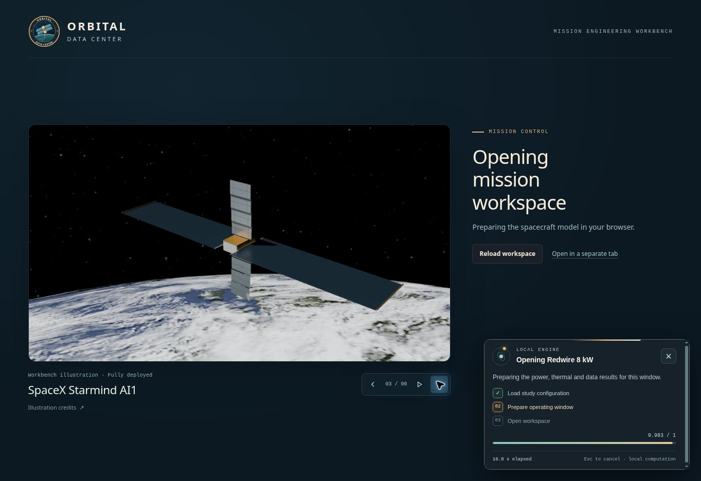
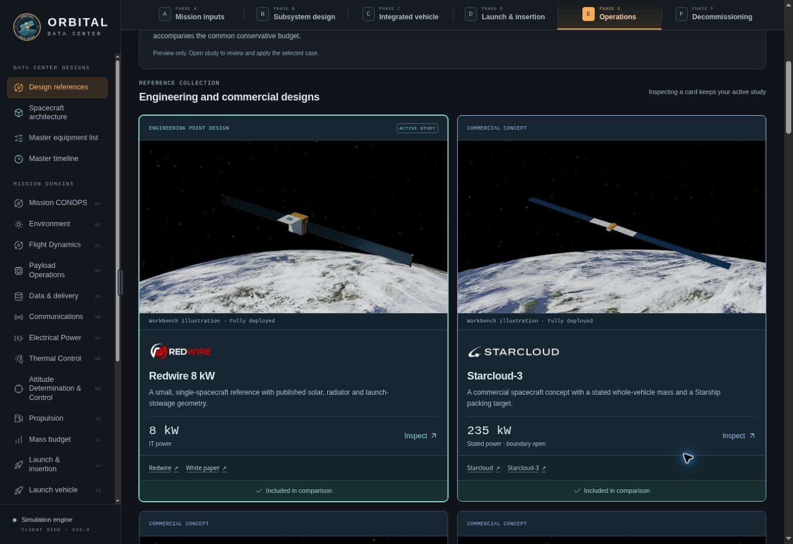

# Supplied reference graphics — 7 November 2026

## Delivery

Integrated all six reference-carousel v2 illustrations into the existing workbench. The ID mapping follows the current `odc-study-2026-11-r2` catalog; the June and September Orbital configurations remain separate. Images are unchanged supplied assets, displayed in uncropped 16:9 frames. Company and mission logos remain separately sourced through the existing branding module.

New placements: optional startup carousel, reference cards and selected dossier, comparison column headers, active-design identity, reference-study review, saved-design rows, and 3D loading/error placeholders. Original architecture schematics remain in an accessible disclosure. Static reference images are labeled so they do not imply a live rendering of an edited variant. Independent designs do not acquire an unrelated reference illustration.

The carousel loads independently of the app, preserves its real work-status display, supports keyboard navigation and reduced motion, and cleans up on successful boot. It adds no minimum loading duration. Art or illustration-module failure cannot stop the app from opening.

Six 960 px WebPs and one 1920 px WebP total 399,620 bytes. Open Graph/Twitter link previews reuse the original 1920×1080 Starmind WebP. Source archives, GLBs and Blender files are not deployed. The offline asset manifest includes all 16 new deliverable files.

`illustration-credits.html` records the supplied AGPLv3 project license, Solar System Scope / INOVE CC BY 4.0 texture credit, NASA SVS / Ernie Wright starfield credit and modification notes. Original metadata and provenance accompany the assets.

## Verification

- Supplied ZIP/source part checksums and all 31 internal asset-manifest hashes verified during intake.
- JavaScript syntax, static manifest existence/uniqueness, HTML ID/metadata uniqueness and `git diff --check` passed.
- Existing `reference-centers-checks.mjs` passed. Focused rendering assertions cover all six selected dossiers, comparison subsets, original schematics, current company marks, edited-reference labels and independent/JB fallback.
- CUA browser review at 1364×936: startup art and navigation, real progress layout, active identity, two-column cards, selected Starmind dossier, schematic disclosure and comparison thumbnails. All six comparison images loaded with `object-fit: contain`.
- CUA browser review with actual pages in a temporary 390 px iframe: splash, active banner, single-column cards, study review modal and credits page. No horizontal document overflow (373 px content viewport with the browser scrollbar). The temporary review harness was removed before packaging.
- No preview console errors from terminal.local were reported at the final error-log check.

## Visual evidence

## Package sizing

The first upload exceeded Sites’ 256 MiB expanded static-archive limit by approximately 1.2 MiB. Reusing the existing 1920 px WebP for social metadata removed the duplicate 2.58 MB PNG without removing any of the six illustrations or changing an existing scene asset.

The publisher also counts tar expansion overhead. To fit the final archive without changing existing media, five duplicate 1920 px variants were omitted from deployment. Every reference retains its original 960 px image, the Starmind social preview retains its 1920 px variant, and the startup frame is capped at 960 px. Full-resolution source images remain in the supplied kit.
